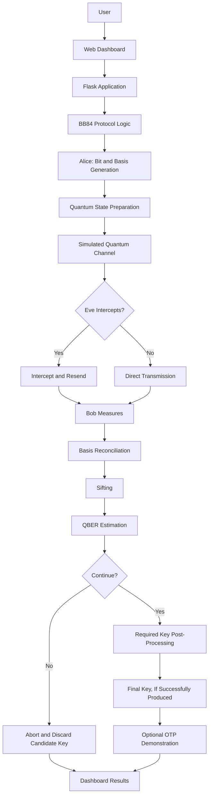

<div align="center">

# 🛡️ CATCH EVE

### A Quantum Key Distribution Simulator Powered by BB84

**Can quantum mechanics help Alice and Bob detect Eve?**

An interactive simulation of quantum key distribution that demonstrates how quantum measurements, random bases, eavesdropping, and channel noise affect the establishment of a shared secret key.

<br>

[](https://www.python.org/)
[](https://www.ibm.com/quantum/qiskit)
[](https://flask.palletsprojects.com/)
[](#-understanding-bb84)

<br>

### 🚀 Explore the Project

[**Open Live Dashboard**](https://catch-eve-kappa.vercel.app/)
&nbsp; • &nbsp;
[**View Project Presentation**](https://docs.google.com/presentation/d/1CGF_AbMhHwpbaTCzGYQOI6B7Gwb31nuh/edit)
&nbsp; • &nbsp;
[**Explore Source Code**](https://github.com/charankumarsbtech25/Catch_Eve)

</div>

---

## 📑 Table of Contents

- [🌌 About the Project](#-about-the-project)
- [🎯 The Problem](#-the-problem)
- [💡 Our Solution](#-our-solution)
- [🧠 Understanding BB84](#-understanding-bb84)
- [👥 Meet Alice, Bob, and Eve](#-meet-alice-bob-and-eve)
- [⚛️ Quantum Computing Fundamentals](#️-quantum-computing-fundamentals)
- [🔄 How the Protocol Works](#-how-the-protocol-works)
- [🕵️ Eve's Intercept-Resend Attack](#️-eves-intercept-resend-attack)
- [📊 Quantum Bit Error Rate](#-quantum-bit-error-rate-qber)
- [🌫️ Understanding Quantum Noise](#️-understanding-quantum-noise)
- [✨ Features](#-features)
- [📈 Dashboard and Visualizations](#-dashboard-and-visualizations)
- [🧪 Simulation Experiments](#-simulation-experiments)
- [🔐 One-Time Pad Demonstration](#-one-time-pad-demonstration)
- [📋 Example Simulation Results](#-example-simulation-results)
- [🏗️ System Architecture](#️-system-architecture)
- [🛠️ Technology Stack](#️-technology-stack)
- [📁 Project Structure](#-project-structure)
- [⚙️ Installation and Setup](#️-installation-and-setup)
- [▶️ Running the Application](#️-running-the-application)
- [🧪 Testing](#-testing)
- [📐 Mathematical Foundations](#-mathematical-foundations)
- [🔒 Security Considerations](#-security-considerations)
- [⚠️ Limitations](#️-limitations)
- [🚀 Future Improvements](#-future-improvements)
- [🎓 Learning Outcomes](#-learning-outcomes)
- [📚 References and Learning Resources](#-references-and-learning-resources)
- [🤝 Contributing](#-contributing)
- [📄 License](#-license)

---

# 🌌 About the Project

**Catch Eve** is an interactive educational simulator for the **BB84 Quantum Key Distribution (QKD) protocol**.

The project explores one of the fundamental questions in quantum cryptography:

> How can two parties establish a shared secret key while detecting potential eavesdropping?

Traditional encryption systems depend on cryptographic keys to protect information. However, before two parties can encrypt their messages using a shared secret, they need a way to establish that key.

BB84 approaches this problem using quantum states and the physical principles governing their measurement.

Catch Eve simulates this process using Python and Qiskit. It models Alice preparing quantum states, Bob measuring them, and Eve potentially intercepting the transmitted states.

An interactive dashboard presents the simulation's measurements, protocol table, quantum circuits, error rates, and key-generation results.

The goal is to make quantum cryptography understandable through experimentation rather than equations alone.

## 🔭 Project at a Glance

| Attribute | Description |
|---|---|
| Project name | Catch Eve |
| Domain | Quantum Computing and Quantum Cryptography |
| Core protocol | BB84 Quantum Key Distribution |
| Primary language | Python |
| Quantum framework | Qiskit |
| Quantum simulation | Qiskit Aer |
| Web backend | Flask |
| Frontend | HTML, CSS, JavaScript |
| Core experiment | Alice–Bob key distribution with optional Eve interception |
| Additional experiment | Quantum channel noise |
| Primary metric | Quantum Bit Error Rate (QBER) |
| Educational demonstration | Shared-key generation and One-Time Pad encryption |
| Application | Interactive quantum protocol simulator |

## 🎯 The Problem

## The Challenge of Secure Key Distribution

Suppose Alice wants to send Bob a confidential message.

Before they can use a shared-key encryption method, both Alice and Bob need access to the same secret key.

The challenge is that an attacker might intercept information exchanged over a communication channel.

If the attacker obtains the secret key, they may be able to compromise messages protected with that key.

This leads to an important question:

**Can Alice and Bob detect suspicious interference while establishing their shared key?**

BB84 explores this question by encoding information in quantum states and comparing measurement outcomes to estimate the disturbance introduced during transmission.

### Why Is This Relevant?

Quantum computing creates new opportunities for scientific computing and cryptography, but it also raises questions about the long-term security of certain classical cryptographic systems.

Some widely used public-key cryptographic algorithms, including RSA, are vulnerable in principle to sufficiently capable fault-tolerant quantum computers running appropriate algorithms.

Quantum Key Distribution provides a different approach to key establishment: it uses quantum communication and protocol-level checks rather than relying solely on the computational difficulty of a mathematical problem.

However, QKD does not replace all cryptographic systems or eliminate every security risk.

It addresses a specific problem: establishing shared key material under defined physical and protocol assumptions.

---

# 💡 Our Solution

Catch Eve implements a simulated BB84 protocol and makes its operation visible through an interactive web interface.

Users can experiment with the number of transmitted qubits, the probability of Eve intercepting them, channel noise, and the configured error threshold.

The simulator then evaluates how these conditions influence Alice's and Bob's measurement results.

### The Core Workflow

1. Alice generates random classical bits.
2. Alice randomly chooses a quantum basis for each bit.
3. Alice encodes her bits into simulated quantum states.
4. Eve may intercept and measure selected states.
5. Bob independently chooses measurement bases and measures the received states.
6. Alice and Bob compare their basis choices over a classical channel.
7. Positions with different bases are discarded.
8. A sample of the remaining bits is compared to estimate QBER.
9. The protocol determines whether to abort or proceed.
10. Further processing is required before the remaining key material can be considered suitable for secure use.

The dashboard visualizes these stages and helps users understand the effects of eavesdropping and noise.

### What Makes the Demonstration Useful?

Instead of treating quantum cryptography as a purely theoretical topic, Catch Eve provides a way to investigate its behaviour experimentally.

Users can explore questions such as:

- Why do Alice and Bob randomly choose measurement bases?
- Why are some bits discarded?
- How can an incorrect measurement disturb a quantum state?
- Why does an intercept-resend attack introduce errors?
- How does channel noise affect the measured error rate?
- Why does a protocol sometimes abort instead of generating a usable key?
- Why is a sifted key not automatically a secure final key?

---

# 🧠 Understanding BB84

BB84 is a quantum key distribution protocol introduced by Charles Bennett and Gilles Brassard in 1984.

The name comes from the authors' surnames and the year of publication.

Its central idea is to encode classical bits into quantum states prepared using randomly selected bases.

Because measurement outcomes depend on the basis used, an eavesdropper who does not know the preparation basis may introduce detectable errors.

## The Two Bases

Our simulation uses two bases: the **Z basis** and the **X basis**.

### 1. Z Basis — Computational Basis

The Z basis represents the states:

| Classical bit | Quantum state | Meaning |
|---|---|---|
| 0 | `|0⟩` | Zero state |
| 1 | `|1⟩` | One state |

These states can be measured in the computational basis to obtain their corresponding bit values in an ideal simulation.

### 2. X Basis — Hadamard Basis

The X basis represents the states:

| Classical bit | Quantum state | Meaning |
|---|---|---|
| 0 | `|+⟩` | Positive superposition state |
| 1 | `|−⟩` | Negative superposition state |

The states are defined as:

`|+⟩ = (|0⟩ + |1⟩) / √2`

`|−⟩ = (|0⟩ − |1⟩) / √2`

When these states are measured in the X basis, their encoded values can be recovered ideally.

When measured in the incompatible Z basis, their outcomes are probabilistic.

This basis dependence is central to the BB84 protocol.

---

# 👥 Meet Alice, Bob, and Eve

The protocol uses three familiar names to represent the participants.

## 👩 Alice — The Sender

Alice initiates the process.

She generates a random bit string and independently chooses a basis for each bit.

For example:

| Position | Alice's bit | Alice's basis |
|---|---:|---|
| 0 | 1 | X |
| 1 | 0 | Z |
| 2 | 1 | X |
| 3 | 0 | Z |
| 4 | 1 | Z |

Alice encodes the bits as quantum states and transmits them through the simulated channel.

She does not publicly announce her secret bit values during basis reconciliation.

## 👨 Bob — The Receiver

Bob receives the simulated quantum states.

He independently chooses a random basis for each received state and measures it.

If Bob's basis matches Alice's basis, the encoded bit should be recovered correctly in the ideal noiseless case.

If the bases differ, Bob's measurement may produce a result unrelated to Alice's original bit.

Alice and Bob subsequently announce their basis choices over a classical channel and discard positions where their choices differ.

## 🕵️ Eve — The Eavesdropper

Eve represents a potential attacker attempting to obtain information about the transmitted states.

In the intercept-resend attack model, Eve:

1. Intercepts a quantum state.
2. Chooses a measurement basis.
3. Measures the intercepted state.
4. Prepares a replacement state based on her measurement.
5. Sends the replacement state onward to Bob.

Eve does not know Alice's original basis choices.

Consequently, Eve sometimes measures in the wrong basis and introduces errors that can be detected statistically.

**Important:** Detecting a high error rate does not identify its cause with certainty. Channel noise and other implementation imperfections can also cause errors.

---

# ⚛️ Quantum Computing Fundamentals

This section introduces the terminology used throughout the project.

## 1. Classical Bit

A classical bit represents either `0` or `1`.

Classical bits are used by Alice to represent the original information and by the simulator to store measurement results.

## 2. Qubit

A qubit is the basic unit of quantum information.

Unlike a classical bit, a qubit can be prepared in a superposition of basis states.

In our project, Qiskit represents qubits through quantum circuits executed by a simulator.

## 3. Superposition

A superposition is a quantum state expressed as a combination of basis states.

For example:

`|+⟩ = (|0⟩ + |1⟩) / √2`

When measured in the Z basis, this state produces `0` or `1` with equal probability.

Superposition does not mean that a measurement simply reveals two classical values simultaneously.

The measurement basis determines the possible outcomes and their probabilities.

## 4. Quantum Measurement

Measurement converts a quantum state into a classical result.

The probability of each result depends on the state and the measurement basis.

Measurement is especially important in BB84 because Eve's attempt to measure an unknown state can affect the state that reaches Bob.

## 5. Quantum Gates

Quantum gates are operations that transform quantum states.

Catch Eve uses quantum circuits to represent state preparation, basis transformations, and measurement.

Two relevant gates are:

- **X gate:** Flips `|0⟩` to `|1⟩` and vice versa.
- **Hadamard gate (H):** Transforms computational-basis states into the corresponding X-basis superposition states.

For example:

`H|0⟩ = |+⟩`

`H|1⟩ = |−⟩`

The Hadamard gate is therefore useful for implementing the X basis in a Qiskit circuit.

## 6. Quantum Circuit

A quantum circuit is a sequence of quantum operations applied to one or more qubits.

In our implementation, Qiskit circuits model the operations required for state preparation and measurement.

The circuit viewer helps users inspect these operations.

## 7. Quantum Simulator

A quantum simulator models quantum circuits on a conventional computer.

Qiskit Aer provides simulation tools for executing quantum circuits and modelling selected noise processes.

This allows the project to explore quantum protocol behaviour without requiring a physical quantum processor.

## 8. Classical Communication Channel

Alice and Bob need an ordinary communication channel to announce their basis choices and compare selected measurement results.

The classical channel does not carry the simulated quantum states.

In a real QKD system, the classical communication must be authenticated to prevent impersonation and man-in-the-middle attacks.

## 9. Sifting

Sifting is the process of discarding positions where Alice and Bob chose different bases.

The bits retained after sifting form the sifted key.

Sifting does not, by itself, establish that the key is secure.

## 10. Quantum Bit Error Rate

QBER measures the fraction of compared bits that disagree.

It provides an estimate of the disturbance observed during the protocol.

A high QBER may cause the protocol to abort.

---

# 🔄 How the Protocol Works

The following sequence describes the complete conceptual workflow.

## Step 1 — Random Bit Generation

Alice generates a random sequence.

Example:

`1 0 1 1 0 0 1 0`

Each bit is intended to contribute to the eventual shared key.

## Step 2 — Random Basis Selection

Alice chooses either X or Z independently for every bit.

Example:

`X Z X X Z Z X Z`

The basis choices are not announced before the quantum transmission.

## Step 3 — State Preparation

Alice encodes each bit into a quantum state.

Examples:

- Bit `0`, Z basis → `|0⟩`
- Bit `1`, Z basis → `|1⟩`
- Bit `0`, X basis → `|+⟩`
- Bit `1`, X basis → `|−⟩`

The states are represented using Qiskit circuits.

## Step 4 — Transmission Through the Channel

The simulated states pass through the quantum channel.

Depending on the experiment, the channel may include:

- No eavesdropping and no noise.
- Eve's intercept-resend attack.
- Simulated quantum noise.
- Both interception and noise.

## Step 5 — Bob Measures the States

Bob independently selects X or Z for each state and records the results.

When the bases match and the channel is ideal, the result should match Alice's encoded bit.

## Step 6 — Basis Reconciliation

Alice and Bob announce their basis choices over the classical channel.

They retain only positions where their bases match.

Example:

| Position | Alice's basis | Bob's basis | Decision |
|---|---|---|---|
| 0 | X | X | Keep |
| 1 | Z | X | Discard |
| 2 | Z | Z | Keep |
| 3 | X | Z | Discard |
| 4 | X | X | Keep |

This process produces the sifted key.

## Step 7 — Parameter Estimation

Alice and Bob compare a randomly selected sample of their sifted bits.

The fraction of mismatches is used to estimate QBER.

The bits disclosed for this test must not be reused as secret key material.

## Step 8 — Abort or Continue

The estimated QBER is evaluated against the configured decision criteria.

If the error rate is too high, the protocol aborts and the candidate key must not be used.

A result below a configured threshold does not automatically establish security. A complete protocol requires an appropriate security analysis and post-processing procedure.

## Step 9 — Final Key Processing

If the protocol continues, practical key establishment requires further processing, including:

- Error correction or information reconciliation.
- Verification that the reconciled keys agree.
- Privacy amplification.
- Appropriate authentication and security checks.

The resulting final key should only be used when the required processing succeeds.

---

# 🕵️ Eve's Intercept-Resend Attack

The intercept-resend attack is one of the central experiments in Catch Eve.

Eve intercepts a quantum state and measures it using a randomly selected basis.

If Eve chooses the same basis as Alice, she can ideally recover the encoded bit without introducing an error through this attack.

If Eve chooses the wrong basis, the measurement result is random relative to Alice's intended bit.

Eve then sends a replacement state to Bob.

This can cause Bob to obtain a result that differs from Alice's original bit even when Bob later chooses the correct basis.

## Why Does the Attack Introduce Errors?

For the standard idealized intercept-resend attack:

1. Eve chooses the wrong basis with probability `1/2`.
2. Conditional on that wrong-basis measurement, the replacement state causes an incorrect result at Bob with probability `1/2` when Bob uses Alice's basis.
3. Therefore, the expected error contribution among sifted bits is:

`1/2 × 1/2 = 1/4 = 25%`

This is the expected QBER when Eve intercepts every qubit in the standard ideal model, with no other channel noise.

It is a statistical expectation, not a guarantee that every finite run returns exactly 25%.

## Partial Interception

If Eve attacks only a fraction of the transmitted qubits, the expected attack contribution is lower.

Under the ideal model, with independent random basis choices and no other errors:

`Expected QBER ≈ 0.25 × interception fraction`

For example, if Eve attacks 30% of transmitted qubits:

`Expected attack contribution ≈ 0.25 × 0.30`

`Expected attack contribution ≈ 7.5%`

This approximation assumes the standard attack model and QBER calculated on the sifted bits. Additional noise and finite sampling affect the observed result.

---

# 📊 Quantum Bit Error Rate (QBER)

QBER is one of the most important metrics in the dashboard.

It quantifies how often the compared bits disagree.

The basic formula is:

`QBER = Number of mismatched compared bits / Total compared bits`

Expressed as a percentage:

`QBER (%) = (Mismatches / Compared bits) × 100`

## Example

Suppose Alice and Bob compare 100 sifted bits.

If 12 bits disagree:

`QBER = 12 / 100 = 0.12`

Therefore:

`QBER = 12%`

The interpretation depends on the configured security criteria.

A low error rate may be consistent with normal operation, while a high error rate may indicate excessive disturbance.

However, QBER alone cannot distinguish eavesdropping from channel noise.

## Abort Threshold

The dashboard provides a configurable threshold.

If the implementation uses `0.2`, that corresponds to 20%.

For example:

| Measured QBER | Configured threshold | Basic comparison |
|---:|---:|---|
| 3% | 20% | Below threshold |
| 13.4% | 20% | Below threshold |
| 20% | 20% | Equal to threshold |
| 25% | 20% | Above threshold |

The actual abort decision depends on the application's comparison logic and other protocol requirements.

**A threshold comparison is not a complete security proof.**

A production security decision must account for the protocol variant, parameter-estimation method, finite-key effects, error correction, privacy amplification, and implementation assumptions.

---

# 🌫️ Understanding Quantum Noise

Quantum noise represents unwanted changes in the simulated quantum process.

In a physical system, noise can arise from imperfect operations, environmental interactions, and limitations in the communication channel.

In Catch Eve, a noise model allows us to explore how imperfect transmission changes measurement results.

## Why Include Noise?

Without noise, a simulation can demonstrate the ideal protocol but cannot explore realistic sources of errors.

By varying the configured noise, users can observe how the error rate and key-generation decision change.

## Noise Versus Eavesdropping

Both noise and eavesdropping can introduce errors.

For example:

- An attacker may disturb the transmitted states.
- A noisy channel may change the states even without an attacker.
- Both may occur simultaneously.

Therefore, an elevated QBER indicates observed disturbance, not definitive proof that Eve is present.

## Noise Experiments

The dashboard can be used to compare runs with different configured noise levels.

The exact interpretation depends on how the noise parameter is mapped to the Qiskit Aer noise model in the implementation.

The relationship should be verified against the source code rather than assumed from the slider value alone.

---

# ✨ Features

Catch Eve combines quantum circuit simulation with a visual interface for exploring the BB84 protocol.

## 1. Configurable Simulation

The dashboard provides controls for experimenting with simulation parameters, including:

- Number of transmitted qubits.
- Eve's interception percentage.
- Configured channel-noise level.
- QBER abort threshold.
- Random seed.

These controls allow users to compare different experimental conditions.

## 2. Alice–Bob–Eve Protocol Simulation

The protocol models:

- Alice's random bits.
- Alice's basis selection.
- Eve's optional interception.
- Eve's basis and measurement result.
- Bob's basis selection.
- Bob's measurement results.
- Bit comparisons.

## 3. Protocol Table

The protocol table provides a per-qubit view of the experiment.

It allows users to trace individual transmission positions and understand how basis selection and interception affect the results.

## 4. QBER Analysis

The simulator calculates or displays an error-rate metric to help users evaluate disturbance.

The result can be compared with the configured abort threshold.

## 5. Quantum Circuit Visualization

The circuit viewer helps users inspect the quantum operations used in the simulation.

It provides a visual connection between the quantum concepts and the implementation.

## 6. Measurement Histogram

The histogram illustrates the distribution of measurement outcomes for the selected demonstration.

It helps explain how a quantum state may produce deterministic or probabilistic results depending on the measurement basis.

## 7. State Comparison and Fidelity

The state comparison section illustrates relationships between selected quantum states.

For pure quantum states, fidelity can be used to quantify their similarity.

The interpretation depends on the definition and calculation used by the implementation.

## 8. QBER and Threshold Visualization

The dashboard compares measured QBER with a configured cutoff.

This makes the abort decision easier to understand.

## 9. Noise and Interception Experiments

Parameter sweeps can be used to examine how error rates respond to changes in attack and noise settings.

These visualizations should be validated against the underlying simulation before drawing quantitative conclusions.

## 10. One-Time Pad Demonstration

The application includes an illustrative message-encryption panel.

The demonstration connects key generation to a practical cryptographic concept: using a shared secret key to protect a message.

A usable key must be available before the encryption stage can proceed.

---

# 📈 Dashboard and Visualizations

The dashboard is designed to help users connect the underlying quantum operations with the resulting protocol measurements.

## Simulation Controls

These controls configure the experiment.

| Control | Purpose |
|---|---|
| Qubit count | Determines the number of transmissions to simulate |
| Eve interception | Controls the fraction of qubits selected for interception |
| Channel noise | Configures the noise experiment |
| Abort threshold | Sets the displayed decision cutoff |
| Random seed | Helps make simulation runs reproducible when all relevant random generators are controlled |

## Summary Metrics

### QBER

Shows the measured error rate for the run.

### Sifted Length

Shows how many positions remain after Alice and Bob discard basis mismatches.

With independent, uniformly random choices between two bases, approximately half of the transmitted positions are expected to survive sifting.

### Final Key Length

Shows the number of bits produced by the application's final-key stage.

A zero-length key means the application has not produced a usable final key for that run.

### Protocol Status

Indicates the application's current decision, such as whether the measured QBER is below or above the configured threshold.

The status should not be interpreted as an unconditional guarantee of security.

## Key Funnel

A complete key funnel should distinguish:

1. Transmitted qubits.
2. Basis-matched sifted bits.
3. Bits disclosed for parameter estimation and then discarded.
4. Bits remaining after information reconciliation.
5. Final key bits after privacy amplification.

The number of bits generally decreases as these stages progress.

## QBER Versus Eve Interception

This visualization is intended to show how the measured error rate changes as the attack fraction changes.

Under the ideal intercept-resend model, the expected QBER increases with the fraction of qubits attacked.

The actual graph must be validated against the implemented attack model and the QBER calculation.

## QBER Versus Channel Noise

This visualization is intended to show the relationship between configured noise and observed errors.

The trend depends on the selected noise model.

Axis labels, units, and plotted data should be checked to ensure the visualization accurately represents the simulation.

## Circuit Viewer

The circuit viewer presents the quantum operations for a selected example.

It can help explain how gates prepare a state, how basis transformations work, and how measurement produces a classical result.

A single displayed circuit may illustrate one transmission rather than the entire multi-qubit experiment.

## Measurement Histogram

The histogram presents the distribution of measurement outcomes.

For example, the state `|+⟩` measured in the Z basis produces approximately equal numbers of zero and one outcomes over many independent ideal trials.

Actual counts vary because measurements are probabilistic.

## Protocol Table

The protocol table shows individual transmission records.

The table is useful for understanding why a specific position was retained or discarded and whether its measurement matched Alice's original bit.

---

# 🧪 Simulation Experiments

The following experiments provide a structured way to test the protocol.

## Experiment 1 — Ideal Communication

**Configuration**

- Eve interception: 0%.
- Channel noise: 0%.
- A sufficiently large number of qubits.

**Expected observation**

The QBER should approach zero in the ideal implementation.

Approximately half the transmitted positions should survive basis sifting.

**Purpose**

Establishes a baseline for comparison with attack and noise experiments.

## Experiment 2 — Full Intercept-Resend Attack

**Configuration**

- Eve interception: 100%.
- Channel noise: 0%.

**Expected observation**

The QBER should approach approximately 25% among the sifted bits under the standard ideal intercept-resend model.

**Purpose**

Demonstrates how eavesdropping can disturb quantum states.

## Experiment 3 — Partial Interception

**Configuration**

- Eve interception: 30%.
- Channel noise: 0%.

**Expected observation**

The ideal expected attack contribution is approximately 7.5%, subject to finite-sample variation.

**Purpose**

Examines the relationship between attack intensity and observed errors.

## Experiment 4 — Noise Without Eve

**Configuration**

- Eve interception: 0%.
- Channel noise: varied across several levels.

**Expected observation**

The QBER responds to the selected noise model.

The exact numerical relationship depends on the configured channel model.

**Purpose**

Separates the effect of channel noise from the effect of the simulated attack.

## Experiment 5 — Attack and Noise Together

**Configuration**

- Eve interception: greater than 0%.
- Channel noise: greater than 0%.

**Expected observation**

Both processes may contribute to the measured error rate.

**Purpose**

Explores a more complex simulated communication environment.

## Experiment 6 — Abort Decision

**Configuration**

Choose parameters that produce an error rate above the configured threshold.

**Expected observation**

The protocol should reject the candidate key under the configured decision rule.

**Purpose**

Validates that an unacceptable run does not proceed to encryption.

## Experiment 7 — Successful Key-Processing Path

**Configuration**

Use conditions under which parameter estimation permits the protocol to continue.

**Expected observation**

If all required processing is implemented and succeeds, the system should produce a suitable final key.

**Purpose**

Verifies that sifting, parameter estimation, reconciliation, privacy amplification, and encryption are connected correctly.

Because the results are probabilistic, each experiment should be repeated or run with enough qubits to distinguish genuine trends from random variation.

---

# 🔐 One-Time Pad Demonstration

Catch Eve includes a demonstration that connects the quantum key-distribution workflow with message encryption.

The example message is:

`Hi Bob!`

The One-Time Pad (OTP) is a symmetric encryption method that combines plaintext bits with a secret key using XOR.

## What Is XOR?

XOR is a binary operation that returns `1` when its two input bits differ and `0` when they are the same.

| A | B | A XOR B |
|---:|---:|---:|
| 0 | 0 | 0 |
| 0 | 1 | 1 |
| 1 | 0 | 1 |
| 1 | 1 | 0 |

## Encryption

The plaintext is converted into bits.

The encryption operation is:

`Ciphertext = Plaintext XOR Key`

## Decryption

The recipient applies the same key:

`Plaintext = Ciphertext XOR Key`

Because XOR is reversible when the same key is used, the original plaintext can be recovered.

## Why Is the Key Important?

The One-Time Pad provides information-theoretic secrecy only when its key is:

- Truly random.
- Secret.
- At least as long as the plaintext.
- Used only once.
- Distributed securely.

A generated key must also be reconciled between the communicating parties.

## Why Did Our Example Abort?

In the sample run documented for Catch Eve, the interface displayed:

- Message: `Hi Bob!`
- Key bits used: `0`
- Qiskit circuits: `519`
- Noise model: active
- Decryption result: `[ABORTED — no usable key]`

This means the encryption demonstration did not have a usable final key for that run.

The system should not invent a key or attempt to claim successful secure encryption when the key-generation stage has failed.

The sample run also displayed a QBER of 13.40% against a configured threshold of 20%, while the final key length remained zero.

That combination needs to be investigated in the implementation.

Possible explanations include additional abort conditions, incomplete final-key processing, or inconsistent dashboard state.

The screenshots alone do not establish which explanation is correct.

**A QBER below the displayed threshold does not automatically mean a usable secure key has been generated.**

---

# 📋 Example Simulation Results

The following values are taken from a sample dashboard run and are provided as an illustrative record, not as a guarantee of system performance.

| Parameter | Sample value |
|---|---:|
| Number of qubits | 400 |
| Eve interception | 30% |
| Configured channel noise | 6% |
| Abort threshold | 20% |
| Random seed | 48 |
| Measured QBER | 13.40% |
| Displayed uncertainty | ±3.46% |
| Sifted key length | 195 |
| Final key length | 0 |
| Qiskit circuits | 519 |
| Noise model | Active |
| Encryption result | Aborted — no usable key |

## Interpreting These Values

### Qubit Count: 400

The experiment was configured for 400 transmitted qubits.

### Sifted Length: 195

The application reported 195 positions after sifting.

This is close to the expected half of 400 for independent random basis choices.

### QBER: 13.40%

The displayed error rate was below the configured 20% threshold.

The exact interpretation depends on how the application estimates QBER and handles the sample disclosed for parameter estimation.

### Final Key Length: 0

No final key bits were output by this run.

The encryption panel consequently reported that no usable key was available.

### What Needs Verification?

The application should be checked to ensure that:

1. The status and abort logic use consistent conditions.
2. The QBER calculation uses the intended set of compared bits.
3. The disclosed parameter-estimation sample is removed from secret key material.
4. Final-key generation is connected correctly to the protocol decision.
5. The encryption panel only enables encryption when an appropriate key exists.
6. The displayed circuit count and noise status correspond to the actual simulation.

These checks are important before making quantitative claims about the simulator's correctness.

---

# 🏗️ System Architecture

Catch Eve combines a Python backend, a quantum-circuit simulation layer, and a browser-based interface.

The intended high-level workflow is:



The diagram describes the conceptual processing flow. The exact division of responsibilities between Python modules should be confirmed against the implementation.

## Main Components

### 1. Web Interface

The interface provides simulation controls, tables, summary metrics, and visualizations.

It allows users to inspect the experiment without manually interpreting raw circuit output.

### 2. Flask Application

Flask provides the Python web application layer.

It receives requests, invokes the relevant simulation functions, and returns results to the frontend.

### 3. BB84 Protocol Logic

This component manages the protocol-level operations:

- Random bit generation.
- Basis selection.
- Eve interception.
- Bob's measurements.
- Sifting.
- QBER calculation.
- Protocol decisions.

### 4. Quantum Circuit Simulation

Qiskit represents the quantum operations as circuits.

Qiskit Aer executes the circuits using a classical simulation backend.

### 5. Analysis and Visualization

The analysis layer processes results for display in tables, charts, and summary metrics.

### 6. Key Processing and Encryption

The final stage handles the candidate key and the illustrative encryption workflow.

The stage must not use a key when the protocol has aborted or when a suitable final key has not been produced.

---

# 🛠️ Technology Stack

## Python

Python is the primary implementation language.

It provides the application logic, protocol processing, simulation orchestration, and data analysis.

## Qiskit

Qiskit is used to describe and manipulate quantum circuits.

Relevant concepts include:

- QuantumCircuit.
- Quantum gates.
- Basis transformations.
- Measurement operations.
- Circuit execution.

## Qiskit Aer

Qiskit Aer provides quantum circuit simulation capabilities.

It enables the project to model quantum operations and selected noise processes on a conventional computer.

A simulated circuit is not the same as a physical quantum communication experiment.

## Flask

Flask is a lightweight Python web framework.

It connects the backend logic with the browser interface.

## HTML

HTML defines the structure of the dashboard.

## CSS

CSS controls the layout, typography, spacing, and visual styling.

## JavaScript

JavaScript supports browser-side interactions and the presentation of simulation results.

## Requirements File

`requirements.txt` lists the Python dependencies required by the project.

The exact package versions should be maintained to improve reproducibility.

---

# 📁 Project Structure

The following structure reflects the main files identified in the current project workspace.

```text
Catch_Eve/
│
├── app.py
│   └── Flask application and dashboard routes
│
├── main.py
│   └── Main execution or entry-point logic
│
├── bb84_core.py
│   └── Core BB84 protocol and simulation logic
│
├── test_ibm.py
│   └── IBM Quantum-related test or integration script
│
├── requirements.txt
│   └── Python dependencies
│
├── .gitignore
│   └── Files excluded from Git tracking
│
├── static/
│   └── dashboard.js
│       └── Frontend interactions and dashboard updates
│
└── templates/
    └── dashboard.html
        └── HTML template for the dashboard
```

**Note:** These descriptions indicate the likely roles of the files based on their names and the project structure shared so far. The exact responsibilities should be verified by reading each source file.

---

# ⚙️ Installation and Setup

You can run the Python application locally to explore the simulator.

## Prerequisites

Install:

- Python 3.10 or another version supported by the pinned dependencies.
- Git.
- A code editor such as Visual Studio Code.
- A terminal.

A physical quantum computer is not required for local simulation with Qiskit Aer.

## Step 1 — Clone the Repository

```bash
git clone https://github.com/charankumarsbtech25/Catch_Eve.git
```

Navigate into the project directory:

```bash
cd Catch_Eve
```

## Step 2 — Create a Virtual Environment

On macOS or Linux:

```bash
python3 -m venv .venv
```

Activate it:

```bash
source .venv/bin/activate
```

On Windows PowerShell:

```powershell
python -m venv .venv
.\.venv\Scripts\Activate.ps1
```

A virtual environment keeps the project's dependencies separate from other Python applications.

## Step 3 — Upgrade pip

```bash
python -m pip install --upgrade pip
```

## Step 4 — Install Dependencies

```bash
python -m pip install -r requirements.txt
```

This installs the packages listed in the project's dependency file.

If installation fails, check the Python version and the package versions specified in `requirements.txt`.

## Step 5 — Verify Flask

```bash
python -c "import flask; print('Flask installed successfully')"
```

## Step 6 — Verify Qiskit

```bash
python -c "import qiskit; print('Qiskit installed successfully')"
```

If the project depends on Qiskit Aer, verify that import as well:

```bash
python -c "from qiskit_aer import AerSimulator; print('Qiskit Aer installed successfully')"
```

---

# ▶️ Running the Application

The exact startup command depends on how the application is configured.

For the Flask-based application, try:

```bash
python app.py
```

If `app.py` does not start the development server directly, inspect the entry point and follow the project's actual startup configuration.

When the Flask server starts, it normally prints a local address, for example:

```text
http://127.0.0.1:5000
```

Open the displayed address in your browser.

## Running the Main Entry Point

If the project uses `main.py` as its entry point, the appropriate command may instead be:

```bash
python main.py
```

Use the entry point configured by the implementation; do not run both simultaneously unless the application is designed for that workflow.

## Exploring the Dashboard

Once the application is running:

1. Choose the number of qubits.
2. Set the interception percentage.
3. Configure the channel-noise level.
4. Set the QBER threshold.
5. Run the simulation.
6. Inspect the protocol table.
7. Review the QBER and key-length metrics.
8. Compare different experimental settings.
9. Examine the encryption result.

For a meaningful experiment, change one parameter at a time before testing combinations.

---

# 🧪 Testing

Testing is essential because a visually convincing dashboard does not automatically mean that the protocol is implemented correctly.

## Recommended Test Cases

| Test | Setup | Expected result |
|---|---|---|
| Ideal baseline | Eve 0%, noise 0% | QBER near 0% |
| Full interception | Eve 100%, noise 0% | QBER approaches 25% under the ideal intercept-resend model |
| Partial interception | Eve 30%, noise 0% | Attack contribution approaches 7.5% under ideal assumptions |
| Noise only | Eve 0%, noise varied | Error rate responds to the selected noise model |
| Abort condition | QBER above threshold | Candidate key is rejected |
| Key availability | No usable final key | OTP demonstration aborts |
| Successful processing | Valid run with all required stages implemented | Final key is produced only after required processing succeeds |

## What Should Be Checked?

- Correct basis selection.
- Correct state preparation.
- Correct measurement behaviour.
- Correct Eve interception logic.
- Correct basis reconciliation.
- Correct sifting.
- Correct QBER calculation.
- Correct parameter-estimation sample handling.
- Consistent abort and key-generation logic.
- Correct handling of random seeds.
- Accurate chart labels and units.
- Correct encryption and decryption behaviour.

Randomized experiments should be repeated to account for finite-sample variation.

If a test fails, inspect the underlying circuit and protocol calculations instead of changing the expected value merely to match the current output.

---

# 📐 Mathematical Foundations

The simulator illustrates several important mathematical ideas.

## 1. Quantum State Representation

The Z-basis states are:

`|0⟩ = [1, 0]ᵀ`

`|1⟩ = [0, 1]ᵀ`

The X-basis states are:

`|+⟩ = (|0⟩ + |1⟩) / √2`

`|−⟩ = (|0⟩ − |1⟩) / √2`

These four states form the state set used by the standard BB84 encoding scheme.

## 2. Hadamard Transformation

The Hadamard gate is represented by:

`H = (1/√2) × [[1, 1], [1, -1]]`

It transforms computational-basis states into X-basis states.

Applying the gate twice returns the original state:

`H × H = I`

where `I` is the identity operation.

## 3. Sifting Probability

Alice and Bob independently choose between two bases with equal probability.

The probability that their bases match is:

`P(match) = P(X, X) + P(Z, Z)`

`P(match) = 1/4 + 1/4 = 1/2`

Therefore, the expected sifted-key length before parameter-estimation sampling is approximately:

`Expected sifted length = Number of transmitted qubits × 1/2`

For 400 transmitted qubits:

`Expected sifted length ≈ 200`

A reported value of 195 is plausible for a randomized run.

## 4. Ideal Intercept-Resend Error Rate

For the standard intercept-resend attack on every qubit:

`P(wrong Eve basis) = 1/2`

When Eve chooses the wrong basis, the replacement state causes an incorrect bit with probability `1/2` when Bob measures in Alice's basis.

Therefore:

`Expected QBER = 1/2 × 1/2 = 1/4`

`Expected QBER = 25%`

This calculation assumes the ideal model without other noise.

## 5. QBER

The basic formula is:

`QBER = Errors / Compared bits`

For example:

`QBER = 13 / 100 = 13%`

The denominator must correspond to the exact bit set used by the implementation's estimator.

## 6. One-Time Pad

The encryption operation is:

`C = M ⊕ K`

The decryption operation is:

`M = C ⊕ K`

Where:

- `M` is the plaintext.
- `C` is the ciphertext.
- `K` is the secret key.
- `⊕` denotes bitwise XOR.

The security properties of the One-Time Pad depend on the key requirements described earlier.

---

# 🔒 Security Considerations

Catch Eve is an educational simulator, not a certified cryptographic product.

Its outputs should be interpreted within the assumptions of the implemented model.

## QBER Is Not Proof of an Attack

An elevated QBER indicates disturbance in the compared data.

It does not establish that an attacker caused the disturbance.

## A Low QBER Does Not Guarantee Security

Security depends on more than a single error-rate comparison.

The protocol must account for information revealed during parameter estimation, the reconciliation process, and privacy amplification.

## Authentication Matters

A real QKD implementation requires an authenticated classical communication channel.

Without authentication, an attacker may impersonate the communicating parties.

## Sifted Bits Are Not Automatically Secure

Sifting only removes positions where the bases differ.

Additional checks and post-processing are required before the key can be treated as suitable for cryptographic use.

## Simulation Is Not Physical Transmission

Qiskit Aer models quantum circuits computationally.

It does not demonstrate that the same system has been implemented successfully over a real optical fibre or physical quantum communication channel.

## Protect Credentials

Do not commit API tokens, passwords, private keys, or `.env` files to the repository.

If IBM Quantum credentials are used for an optional integration, store them outside source control.

---

# ⚠️ Limitations

The current project is a simulation-based educational demonstration.

Its limitations include:

- Simulated rather than physical quantum transmission.
- Dependence on the accuracy of the circuit and noise models.
- Statistical variation across randomized runs.
- Simplified security decisions when using a fixed abort threshold.
- Need for correct parameter estimation and final-key processing.
- Need to verify the consistency of the status, QBER, and final-key metrics.
- No guarantee of production-grade security from a dashboard result alone.

A successful simulation run is evidence that the implemented model executed under its assumptions. It is not, by itself, a formal proof of security.

---

# 🚀 Future Improvements

Catch Eve can be extended in several directions.

## 1. Improve Key-Generation Consistency

Ensure that the protocol decision, final key length, and encryption availability reflect the same underlying result.

A run should not claim that a usable key exists when the key-generation pipeline has failed.

## 2. Implement Complete Post-Processing

Add or validate:

- Parameter estimation.
- Information reconciliation.
- Verification of matching keys.
- Privacy amplification.
- Final-key validation.

## 3. Improve Statistical Reporting

Display the number of bits used for QBER estimation, the number of observed errors, and the uncertainty associated with the estimate.

Explain whether the reported metric uses the full sifted key or a disclosed sample.

## 4. Validate Attack and Noise Models

Test the implementation against expected ideal results.

Confirm that changing the interception and noise parameters actually changes the corresponding simulation settings.

## 5. Improve Visualizations

Provide clear, correctly labelled charts for:

- QBER versus Eve interception.
- QBER versus channel noise.
- Sifting efficiency.
- Key-length reduction.
- Protocol success and abort rates across repeated runs.

## 6. Add Experiment Comparison

Allow users to save several runs and compare them side by side.

This would help demonstrate the difference between ideal operation, eavesdropping, and noisy transmission.

## 7. Add Reproducible Experiments

Ensure that all random components are handled consistently when a seed is provided.

Display the configuration associated with every recorded result.

## 8. Improve Educational Explanations

Provide tooltips and short explanations for quantum states, measurement bases, QBER, and the abort decision.

## 9. Improve Automated Testing

Add unit tests for the state-preparation logic, basis matching, sifting, QBER, and abort conditions.

Use statistical tests for probabilistic behaviour rather than expecting every randomized run to return one exact value.

## 10. Explore Physical Quantum Hardware

A future extension could investigate executing appropriate circuits on supported quantum hardware.

This would require separate evaluation of hardware compatibility, circuit execution, noise, connectivity, and runtime limitations.

---

# 🎓 Learning Outcomes

Developing Catch Eve provides an opportunity to explore:

- Quantum computing fundamentals.
- Qubits and superposition.
- Quantum measurement and basis selection.
- Quantum circuit construction.
- BB84 quantum key distribution.
- Intercept-resend attacks.
- Quantum channel noise.
- Error-rate analysis.
- Classical and quantum communication.
- Python application development.
- Flask-based web applications.
- Interactive data visualization.
- Cryptographic key management.
- Experimental validation and reproducibility.

The project connects theoretical quantum concepts with a software implementation that can be tested, inspected, and improved.

---

# 📚 References and Learning Resources

The following resources provide background for understanding the technologies and protocol.

### Quantum Computing

- [IBM Quantum](https://quantum.ibm.com/)
- [Qiskit Documentation](https://docs.quantum.ibm.com/)
- [Qiskit Textbook](https://learning.quantum.ibm.com/)

### Quantum Circuit Simulation

- [Qiskit Aer Documentation](https://qiskit.github.io/qiskit-aer/)

### Web Development

- [Python Documentation](https://docs.python.org/3/)
- [Flask Documentation](https://flask.palletsprojects.com/)

### Source Code and Project Demonstration

- [Catch Eve — GitHub Repository](https://github.com/charankumarsbtech25/Catch_Eve)
- [Catch Eve — Live Dashboard](https://catch-eve-kappa.vercel.app/)
- [Catch Eve — Project Presentation](https://docs.google.com/presentation/d/1CGF_AbMhHwpbaTCzGYQOI6B7Gwb31nuh/edit)

---

# 🤝 Contributing

Contributions that improve correctness, clarity, reproducibility, and usability are welcome.

## Suggested Contribution Areas

- BB84 protocol validation.
- Quantum circuit correctness.
- QBER calculation.
- Noise-model validation.
- Dashboard improvements.
- Visualization and accessibility.
- Automated testing.
- Documentation.
- Performance and reproducibility.

## Contribution Workflow

1. Fork the repository or obtain collaborator access.
2. Create a branch for your changes.
3. Implement and test the change.
4. Verify that no secrets or credentials are included.
5. Commit your work with a descriptive message.
6. Open a pull request describing the change and its validation.

For changes to protocol logic, include the relevant experiment settings and expected statistical behaviour.

---

# 📄 License

No license has been specified in this README.

Before distributing or reusing the source code, add an appropriate `LICENSE` file to the repository and update this section to reflect the chosen license.

---

<div align="center">

## 🌌 The Key Takeaway

**Quantum key distribution is not simply about generating bits. It is about establishing shared key material while evaluating whether the communication process has been disturbed.**

Catch Eve makes this idea tangible through a simulated BB84 protocol, quantum circuits, attack experiments, error-rate analysis, and an interactive dashboard.

<br>

### Explore. Experiment. Observe. Understand.

**Catch Eve — Exploring the Intersection of Quantum Computing and Cryptography.**

[🌐 Live Dashboard](https://catch-eve-kappa.vercel.app/)
&nbsp; • &nbsp;
[📊 Presentation](https://docs.google.com/presentation/d/1CGF_AbMhHwpbaTCzGYQOI6B7Gwb31nuh/edit)
&nbsp; • &nbsp;
[💻 GitHub Repository](https://github.com/charankumarsbtech25/Catch_Eve)

</div>
